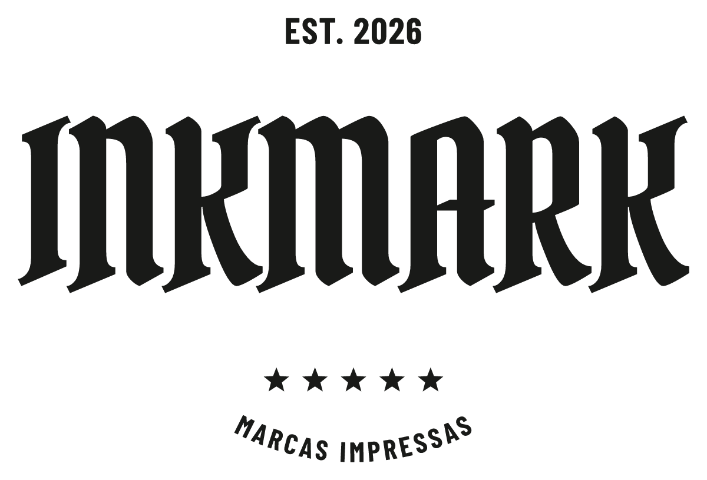

  <picture>
    <source media="(prefers-color-scheme: dark)" srcset="static/brand/inkmark-escura.png">
    
  </picture>

<h1 align="center">Inkmark</h1>

<em>Sua marca, impressa hoje.</em>

<a href="https://inkmark.brunorocha.sh"><strong>inkmark.brunorocha.sh</strong></a>

Inkmark é um estúdio de logos monocromáticas inspirado na gráfica tradicional. Você escreve o nome da sua marca, escolhe uma composição e vê a logo pronta na hora, como se tivesse saído de uma prensa: tinta preta sobre papel, com as falhas de impressão na medida que você escolher.

O site tem o visual de uma primeira página de jornal, *The Inkmark*: a logo é a foto de capa, os controles ficam nas colunas laterais e o catálogo de modelos são os classificados.

## O que dá para fazer

- **239 composições** em três categorias: 37 letterings, 75 selos e 127 emblemas, com brasões, faixas dobradas, rosetas, escudos, carimbos, gravatas, louros e muito mais.
- **11 tipografias** de personalidade (gótica, script, pincel, slab, condensadas), ou a sua própria fonte TTF/OTF.
- **Textos e ajustes:** nome, linha acima e linha abaixo, tamanho, espaçamento entre letras, inclinação e ornamentos (estrelas, losango, montanha).
- **Efeitos de impressão** combináveis, cada um em Sem · Leve · Médio · Forte:
  - **Tinta:** falhas e riscos de impressão que deixam o papel aparecer;
  - **Retícula:** as áreas sólidas viram pontos de jornal;
  - **Pressão desigual:** um lado do carimbo sai cheio e o outro, gasto;
  - **Tinta espalhada:** traços encorpados e cantos arredondados, como tinta no papel.
- **Edições clara e noturna:** logo preta sobre papel ou branca sobre cartão preto.
- **Arquivos prontos para usar:** SVG vetorial com as letras em curvas (sem instalar fontes) e PNG de até 3600 × 3000 pixels, avulsos ou num pacote ZIP, com fundo transparente ou sólido.
- **Prancha do catálogo:** um SVG com todos os modelos de uma categoria, com o seu nome ou com nomes de exemplo.
- **Em português, inglês e espanhol.**
- **Grátis e sem cadastro:** a logo é desenhada no seu navegador e a sua criação fica salva nele. Experimente em [inkmark.brunorocha.sh](https://inkmark.brunorocha.sh).

## A Redação

O catálogo é editado por um painel interno, a *Redação*, protegido por senha. Por ele se escolhe quais modelos aparecem no site, em que ordem, com que nome e categoria, quais ganham destaque e qual abre como padrão no editor. As mudanças valem na hora, sem publicar uma nova versão do site.

## Como funciona

- **As logos são geradas, não desenhadas à mão.** Cada modelo é uma composição vetorial descrita em código; o texto da marca é convertido em curvas com [opentype.js](https://opentype.js.org/) e encaixado na composição. Por isso qualquer nome cabe em qualquer modelo, e o SVG exportado é o mesmo que aparece na tela.
- **Os efeitos de impressão são filtros e máscaras SVG** aplicados sobre a arte, numa ordem fixa, então qualquer combinação dá um resultado previsível.
- **O papel é de verdade:** as texturas do site (jornal, papel preto) foram geradas por código, com fibras, manchas de tom e relevo iluminado por luz rasante.

## Feito com

- [SvelteKit](https://svelte.dev/) e Svelte 5, em TypeScript;
- [Tailwind CSS](https://tailwindcss.com/) 4;
- [Paraglide JS](https://inlang.com/m/gerre34r/library-inlang-paraglideJs) para os idiomas;
- SQLite (o `node:sqlite` do Node 24) para o catálogo da Redação;
- [opentype.js](https://opentype.js.org/) e [JSZip](https://stuk.github.io/jszip/) no navegador;
- Vitest, com mais de 400 testes automatizados, inclusive a regressão de todos os modelos.

## Créditos

As fontes das logos e da interface estão sob a SIL Open Font License, exceto Yellowtail e Special Elite (Apache License 2.0). As licenças acompanham os arquivos em `static/fonts/`.

Os modelos são composições próprias. Lettering feito com fontes não reproduz o trabalho manual de um calígrafo: o Inkmark é um ponto de partida para a sua marca.
